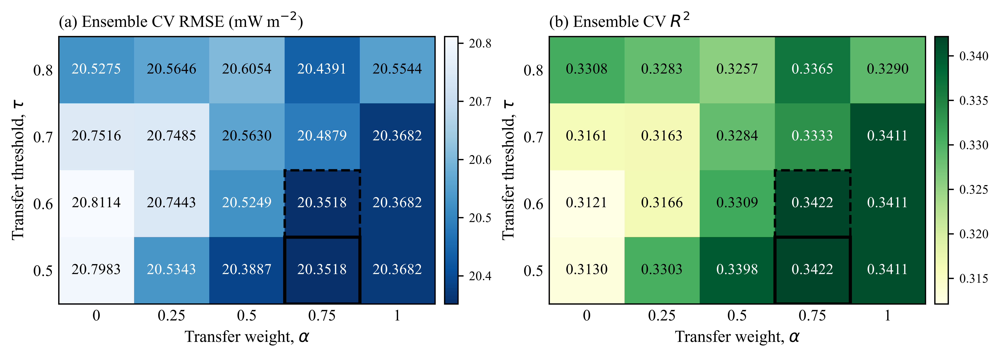
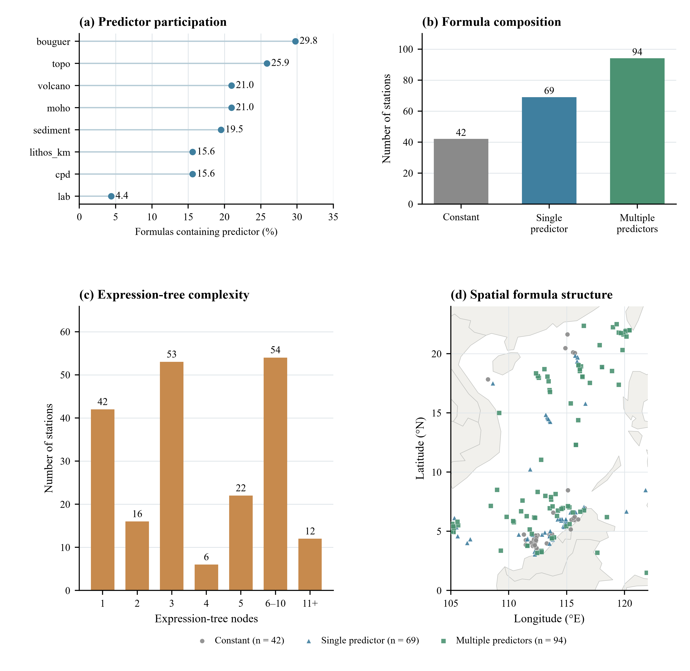

# GST–GWSR reproducibility repository

Current complete experiment, updated 19 October 2026: training-only bandwidth selection, the completed 20-setting GST grid, and the locked 205-station comparison.

The input contains 1,024 marine heat-flow stations and eight geological/geophysical predictors. The fixed 80:20 split uses seed 42 (819 training, 205 evaluation); training-only 3-IQR cleaning retains 815 observations in the complete training set. Transformations are fitted to the relevant training subset. Predictions are evaluated on the original heat-flow scale in mW m⁻².

## Current protocol

- GWSR/GST-GWSR: adaptive bisquare weights and Haversine great-circle distances, Earth radius 6,371.0088 km.
- Five-fold training-only CV over k = 20, 25, 30, 35, 40, 45, 50, 55, 60 selects **k = 55**.
- GST uses geographic similarity and feature similarity from the eight standardized predictors at each target point.
- The completed grid is α ∈ {0, .25, .5, .75, 1}, τ ∈ {.5, .6, .7, .8}: **20 combinations**.
- Selection minimizes pooled 819-station OOF RMSE after averaging the three original-scale predictions at each station. Exact ties use α then τ ascending. The selected setting is **α = .75, τ = .5**.
- GP seeds: 42, 123, 456; population: 1,000; independent search: 20 generations; transferred adaptation: five rounds, with inherited-candidate reevaluation outside those five rounds.
- Each completed parent supplies an archive of at most 1,000 finite, structurally deduplicated candidates retained across generations. The child receives the first 800 candidates plus 200 new random candidates; short archives are filled cyclically and the duplicate count is recorded.
- The released engine preserves the recorded weight construction and search-entry normalization, initialization RNG and final-expression selection.
- Twenty-four task chains, 12 worker processes and one numerical thread per worker; no adaptive stopping or additional semantic/task screening.
- Unsafe predictions use the predefined local weighted-mean protection. Training failures stop the run.

## Recorded results

Three-seed, pointwise original-scale ensemble on the 205 evaluation stations:

| Model | R² | RMSE (mW m⁻²) | MAE (mW m⁻²) |
|---|---:|---:|---:|
| Independent GWSR | 0.625502 | 14.249755 | 10.037380 |
| GST-GWSR | 0.639695 | 13.977112 | 10.137433 |

Completed-batch search wall time summed over three seeds is 512.7787 s for independent GWSR and 260.8627 s for GST-GWSR (49.13% lower). Objective evaluations per seed are 4.100 million and 1.566 million (61.80% lower). Each GST seed has 181 five-round tasks and 24 independent 20-generation tasks. Timing includes parent searches, initialization and archive maintenance; shared preparation, planning, scoring and I/O are excluded. It is descriptive single-pair timing. The interrupted attempt adds at least 27 s outside the completed-batch totals.

The eight external baselines (OLS, GWR, MGWR, RF, GBR, XGBoost, SVR-RBF, GWRF) are included with their aligned retained predictions and fitting implementations. Their results were not newly fitted in the final GWSR/GST run. GWRF has the highest R² and lowest RMSE among the ten models; independent GWSR has the lowest MAE. Full metrics are in [results/model_comparison/metrics.csv](results/model_comparison/metrics.csv).





## Files

| Directory | Contents |
|---|---|
| `src/gwsr/exact/` | Current local objective, GP archive, association and fold preparation |
| `src/baselines/` | Eight external baseline implementations |
| `configs/` | Current protocol and selected parameters |
| `data/processed/` | Exact 1,024-station input |
| `results/k_selection/` | Nine k candidates, seed-fold predictions and ensemble selection |
| `results/gst_cv/` | Four thresholds, 360 batches, 120 ensemble folds, 58,968 task histories |
| `results/final_outer/` | Six batches, 1,230 histories and two 205-station ensembles |
| `results/external_baselines/` | Eight baseline predictions, selected settings and provenance |
| `results/model_comparison/` | Current ten-model comparison |
| `figures/current/` | Current plots in PNG/PDF/SVG |
| `docs/` | Data provenance, protocol and verification details |

## Verify the recorded experiment

Python 3.11.17 and the exact GP dependencies are recorded in `requirements.txt` and `environment.yml`.

```powershell
python -m venv .venv
.\.venv\Scripts\python.exe -m pip install -r requirements.txt
.\.venv\Scripts\python.exe scripts/validate_station_table.py --input data/processed/heat_flow_stations.csv
.\.venv\Scripts\python.exe scripts/verify_results.py
.\.venv\Scripts\python.exe -m unittest discover -s tests
```

Verification checks source-copy SHA-256 values, all ensemble means and metrics, k selection, the 20-setting selection, generation histories, branch counts and independent-search parity. It performs no training.

## Reproduce fresh searches

These commands write new directories and refuse to overwrite existing stage outputs.

```powershell
python scripts/run_experiment.py all --output run_outputs/current --workers 12
```

Individual stages:

```powershell
python scripts/run_experiment.py k-cv --output run_outputs/current
python scripts/run_experiment.py gst-cv --output run_outputs/current
python scripts/run_experiment.py outer --output run_outputs/current
```

To reproduce only the locked final comparison from the recorded training selections:

```powershell
python scripts/run_experiment.py outer --selection-root results --output run_outputs/locked_outer
```

External baselines use their own recorded environment (see `requirements-baselines.txt` and `results/external_baselines/protocol.json`). Run them in a separate environment:

```powershell
python scripts/run_baselines.py --output run_outputs/external_baselines
```

The portable workflow retains the recorded scientific operations and random seeds. The release checks verify extracted core functions against the executed sources and validate preparation/planning against saved arrays; a fresh full training run was not performed while assembling this release.

## Data and citation

Large source rasters use Git LFS; run `git lfs pull` to retrieve them. The exact station table is already included. See [docs/data_sources.md](docs/data_sources.md) and [docs/data_processing_workflow.md](docs/data_processing_workflow.md) for provenance and reconstruction. Code uses the MIT license; data retain their providers' terms.
